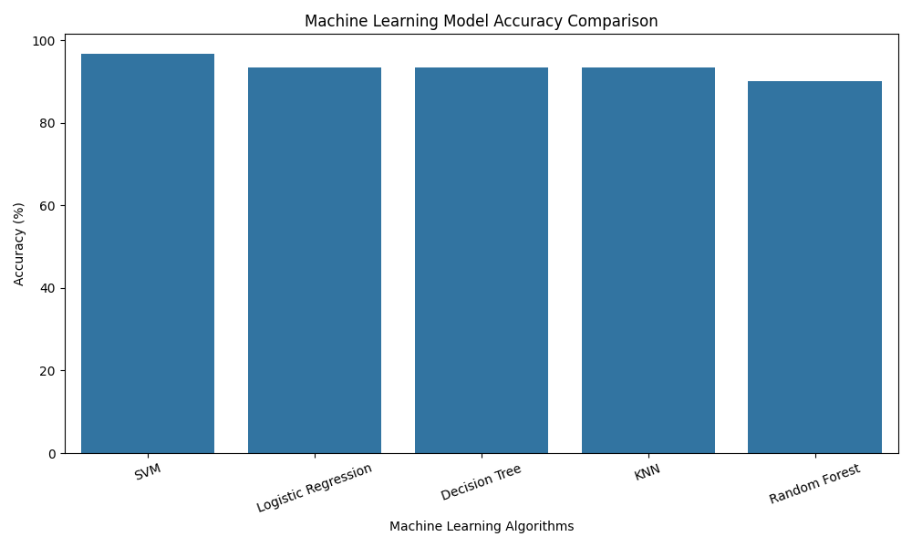

# 🌸 Iris Flower Classification using Machine Learning

## 📌 Project Overview

This project implements a Multi-Class Classification system using Machine Learning to predict Iris flower species based on their physical measurements.

Five different classification algorithms are trained and evaluated to identify the best-performing model.

The Support Vector Machine (SVM) achieved the highest accuracy of **96.67%**.

## 🎯 Objectives

- Understand and explore the Iris dataset.
- Perform data preprocessing and feature scaling.
- Implement multiple classification algorithms.
- Evaluate models using different performance metrics.
- Compare model performance.
- Build a flower species prediction system.

## 📊 Dataset Information

Dataset: Iris Flower Dataset

Source: Seaborn Iris Dataset

Total Records: 150

Total Features: 4

Target Classes: 3

### Input Features

| Feature | Description |
|---|---|
| sepal_length | Length of sepal |
| sepal_width | Width of sepal |
| petal_length | Length of petal |
| petal_width | Width of petal |

### Target Classes

- Setosa
- Versicolor
- Virginica

## 🛠️ Technologies Used

- Python
- Pandas
- NumPy
- Matplotlib
- Seaborn
- Scikit-learn
- Joblib
- Git and GitHub

## 🤖 Machine Learning Algorithms

Five classification algorithms were implemented:

1. Logistic Regression
2. Decision Tree Classifier
3. Random Forest Classifier
4. K-Nearest Neighbors (KNN)
5. Support Vector Machine (SVM)

## ⚙️ Project Workflow

1. Dataset Collection
2. Data Loading
3. Exploratory Data Analysis (EDA)
4. Data Cleaning
5. Label Encoding
6. Train-Test Splitting
7. Feature Scaling
8. Model Training
9. Model Evaluation
10. Model Comparison
11. Flower Species Prediction

## 📈 Model Performance Comparison

The models were evaluated using an 80:20 train-test split.

| Algorithm | Accuracy |
|---|---:|
| Support Vector Machine | 96.67% |
| Logistic Regression | 93.33% |
| Decision Tree | 93.33% |
| K-Nearest Neighbors | 93.33% |
| Random Forest | 90.00% |

### 🏆 Best Performing Model

Support Vector Machine (SVM)

- Accuracy: 96.67%
- Precision: 96.97%
- Recall: 96.67%
- F1-Score: 96.66%

SVM achieved the highest performance among the five evaluated algorithms on the selected test dataset.

## 📊 Model Accuracy Visualization

The following graph compares the accuracy of all five classification algorithms.



## 🔍 Prediction System

A Python-based prediction system was developed using the trained SVM model.

Users can enter four flower measurements:

- Sepal Length
- Sepal Width
- Petal Length
- Petal Width

The system predicts the corresponding Iris flower species.

### Sample Input

```text
Sepal Length: 5.1
Sepal Width: 3.5
Petal Length: 1.4
Petal Width: 0.2
```

### Sample Output

```text
Predicted Flower Species: setosa
```

## 📁 Project Structure

```text
Iris-Flower-Classification/
│
├── iris_classification.py
├── predict_flower.py
├── iris_svm_model.pkl
├── iris_scaler.pkl
├── iris_encoder.pkl
├── model_comparison.csv
├── model_accuracy_comparison.png
└── README.md
```

## 💻 Installation and Execution

### Step 1: Clone the Repository

```bash
git clone https://github.com/PradeepAiTech01/Iris-Flower-Classification.git
```

### Step 2: Navigate to Project Folder

```bash
cd Iris-Flower-Classification
```

### Step 3: Install Required Libraries

```bash
pip install pandas numpy matplotlib seaborn scikit-learn joblib
```

### Step 4: Run Classification Program

```bash
python iris_classification.py
```

### Step 5: Run Prediction System

```bash
python predict_flower.py
```

## 📌 Results and Conclusion

The Iris Flower Classification project successfully implemented five Machine Learning classification algorithms.

Among all the evaluated models, Support Vector Machine achieved the highest accuracy of 96.67%.

The project demonstrates the practical implementation of data preprocessing, classification algorithms, model evaluation, and prediction using Python and Scikit-learn.

## 👨‍💻 Author

**Pradeep Pramnik**

GitHub: PradeepAiTech01

Project: Iris Flower Classification

---

⭐ If you find this project useful, consider giving this repository a star!